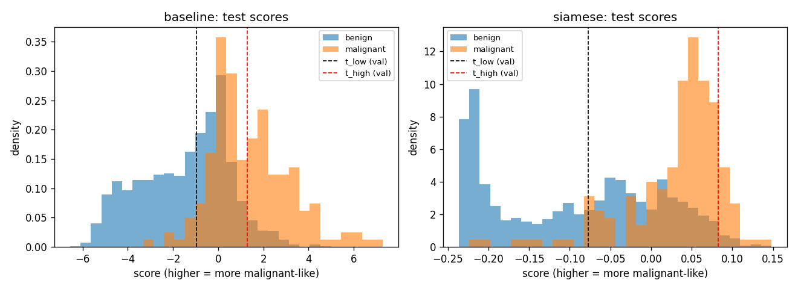
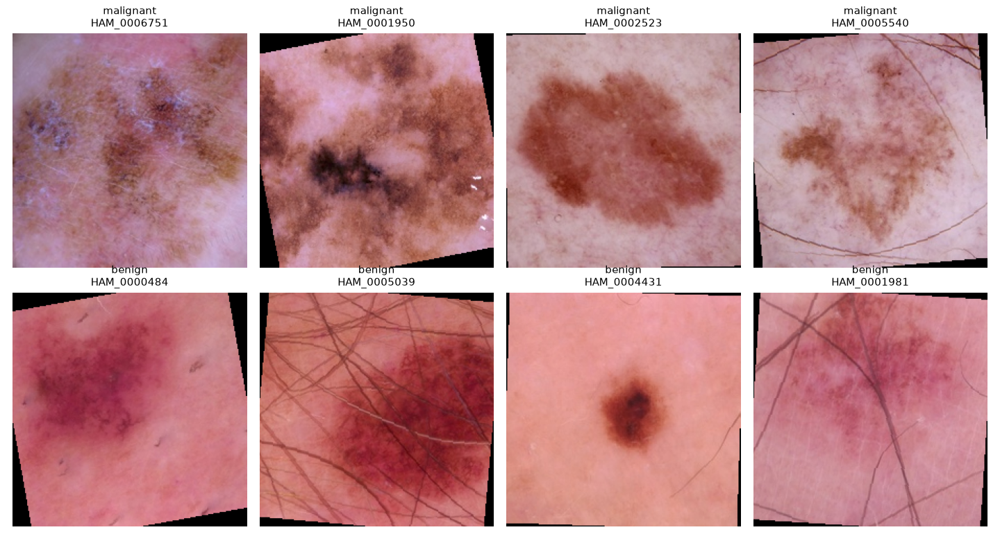
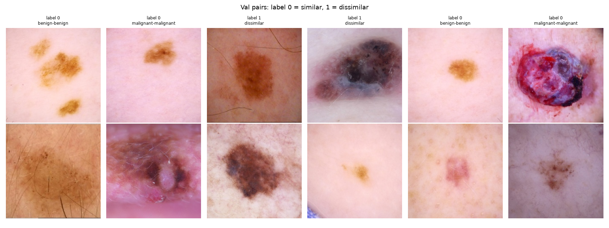
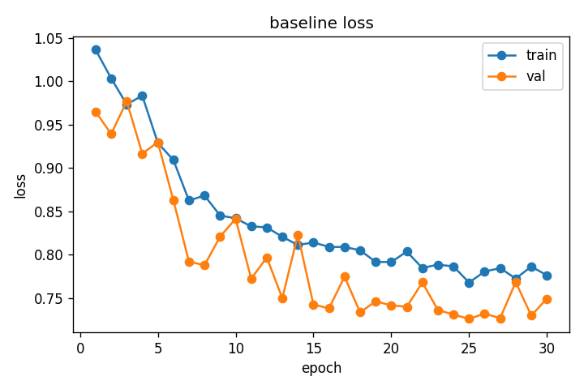
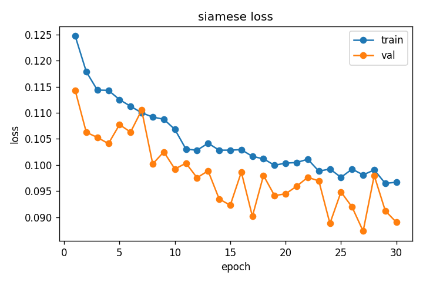
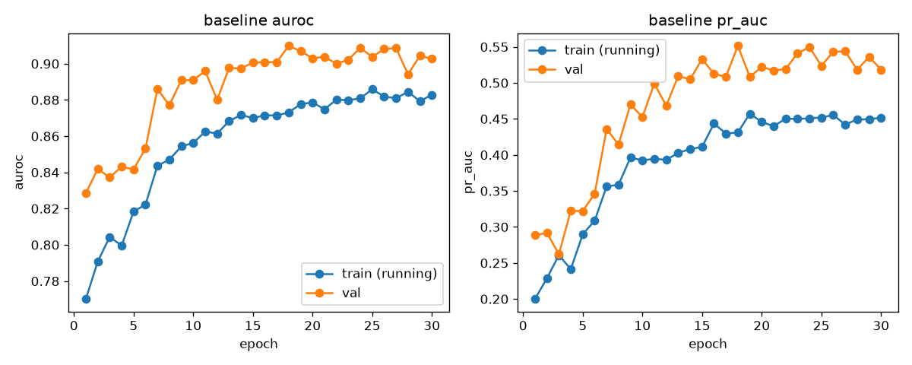
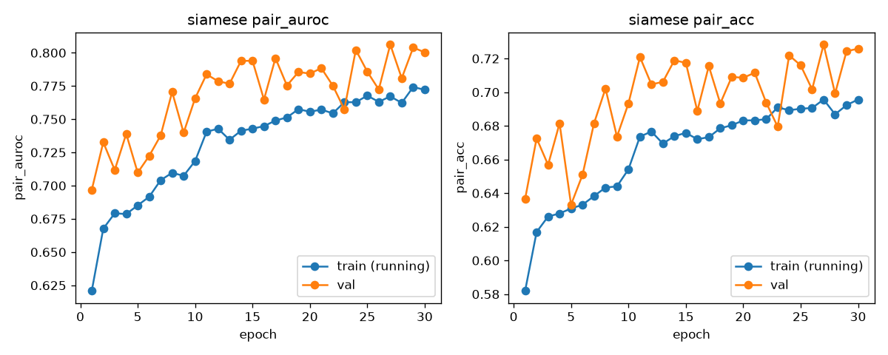
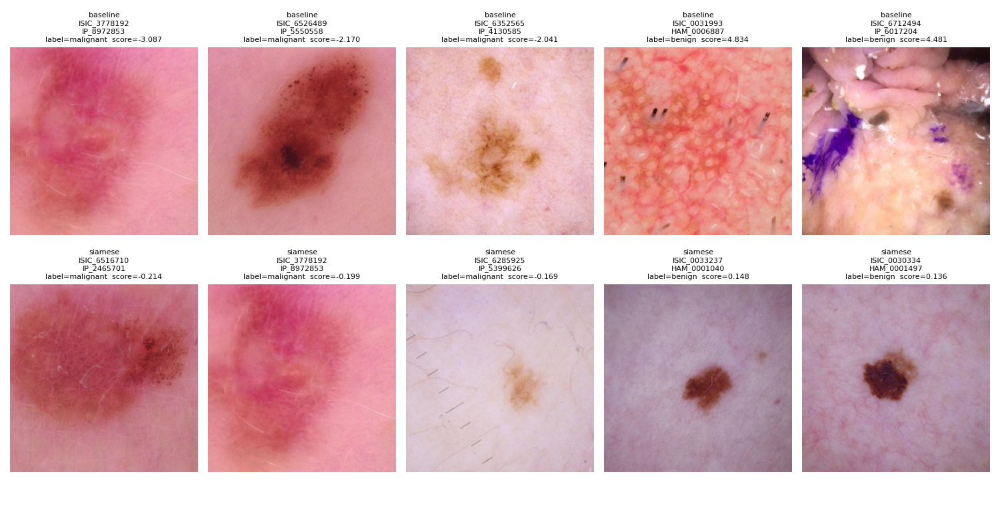

# Siamese network for melanoma triage (ISIC, COMP3710 Hard tier)

## 1. What this does

A skin clinic gets a lot of photos of skin spots. A reviewer has to decide which ones look harmless, which ones need a closer look, and which ones look dangerous (melanoma). This project builds a small model that gives each photo a score for how malignant it looks, then uses two cut-offs to sort photos into three groups: auto-clear, refer to a specialist, or flag. I compare two models on exactly the same test photos:

- A **baseline**: a plain convolutional network that looks at one photo and outputs one number.
- A **Siamese network**: a network that turns a photo into a short list of numbers (an embedding), trained so that photos of the same class end up close together and photos of different classes end up far apart.

The main question is whether the score can be trusted. Does it separate the cases it is sure about from the ones it is guessing, or does it stay confident when it is wrong? And does the extra complexity of the Siamese network pay off?

### How it works

Both models use the same four blocks of convolution, batch normalisation, ReLU and max-pooling (32, 64, 128 and 256 channels), then global average pooling. The baseline ends in one linear layer with one output and is trained with a weighted binary cross-entropy loss (the weight is the number of benign images divided by the number of malignant images in the training split). The Siamese network ends in a linear layer with 128 outputs, then each embedding is scaled to length 1. It is trained on pairs of photos with a contrastive loss (Hadsell et al., 2006): similar pairs (same class, label 0) are pulled together, and dissimilar pairs (label 1) are pushed apart until they are at least the margin (1.0) away. Because every embedding has length 1, the distance between two of them is always between 0 and 2.

To score a new photo, I embed 200 benign and 200 malignant reference photos from the training split. The score is the average distance to the 5 nearest benign references minus the average distance to the 5 nearest malignant references. A higher score means the photo looks more like the malignant references.

Figure: `figures/score_hist.png` shows the test scores of both models. Dashed lines are the two thresholds chosen on the validation split.



## 2. Feasibility review

Shown to my tutor after both models had finished their first full training runs. Feedback: if the Siamese model did not do better than the baseline, run more experiments, such as data augmentation, image pre-processing and a change of learning rate (Section 5b reports what I ran). The text I showed (also a one-page PDF):

**1. User need, scope and acceptance criteria.** The user is a clinic reviewer who has to triage many skin photos. The prototype gives each photo a score and sorts it into auto-clear, refer or flag. It targets the open dilemma: does the score (here, an embedding distance) track whether the answer is right, or does it stay confident when wrong, and where should the cut-offs go to balance missed melanomas against false alarms? Acceptance criteria:

1. The Siamese network and a baseline CNN are scored on the same test split, with AUROC, PR-AUC, melanoma recall and F1, each with a 95% bootstrap interval. I also report accuracy at cut-offs chosen on validation, because the brief mentions about 0.8, but accuracy alone is not enough: saying "benign" every time scores 91.8% on my data.
2. Both cut-offs are chosen on validation only. I report the share of melanomas that end up in the auto-clear tier on test, with an interval, aiming for 95% recall on validation.
3. Confidence check: the malignant rate by score decile, and whether wrong answers sit closer to the cut-off than right ones.
4. Results are reported separately for the two image sources (IP_ and HAM_), because their malignant rates differ.
5. Each model trains in under 2 hours and under 4 GB of GPU memory on one GPU.

**2. Model choice and course concepts.** Data: the 224 by 224 ISIC 2020 copy from Kaggle. I keep the 14,061 images that have a usable patient ID (4,794 IDs, 8.5% malignant) and split 70/15/15 by ID so that images sharing an ID are never in two splits. Difficulty band: Hard. A Siamese network trained from scratch with a contrastive loss (Hadsell et al., 2006; Koch et al., 2015), giving 128-number embeddings of length 1. Training pairs are half similar and half dissimilar, with the rare malignant images oversampled. A photo is scored by its distance to the 5 nearest benign and the 5 nearest malignant reference photos from the training split. The baseline is a CNN with the same four convolution blocks and a weighted cross-entropy loss. This uses the course's convolutional networks, embeddings and train/validation/test discipline.

**3. Preliminary feasibility evidence.** Data audit: 24,493 images in the file; 10,432 have placeholder IDs and were dropped (they hold 77% of the melanomas). Two separate checks find no ID in more than one split. Smoke test: both models ran end to end in a short debug run on a small subset of the images. Resource measurement on the lab T4 (one 30-epoch run each): baseline 18 min and 1.1 GB, Siamese 39.5 min and 2.1 GB, inside criterion 5. First result: AUROC 0.867 for the baseline and 0.846 for the Siamese network.

**4. Risks, budget, next experiment and fallback.** Risks: HAM_ IDs have one image each, so the split is only guaranteed patient-safe for IP_ images; HAM_ images are about 21% malignant and IP_ about 5%, so a model may partly recognise the source; the dropped rows make my data less malignant than the full file; results are for one split. Budget: about 1 hour of T4 time per seed for both models (three seeds, about 3 hours). Next experiment: train the Siamese network for more epochs, since its best epoch was at the end of training. Fallback: if the Siamese network does not beat the baseline, I report that and recommend the baseline with the same triage rule.

## 3. Dependencies and reproducibility

Laptop (Windows, CPU; used for the evaluation and the per-source analysis): Python 3.14.7, torch 2.14.1+cpu, torchvision 0.29.1+cpu, numpy 2.5.2, pandas 3.0.6, matplotlib 3.11.2, pillow 12.3.0.

Lab GPU machine (UQ Virtual GPU Lab, Tesla T4; used for training): Python 3.10, torch 2.14.0+cu130, torchvision 0.29.0+cu130. The course environment on that machine was used as it was, and I did not record the pandas and matplotlib versions there.

Seeds and settings:

- Seed 42 for the split, the reference set, the bootstrap and training. The validation and test pairs use seeds 43 and 44 (seed plus 1 and seed plus 2).
- Two runs of the split with seed 42 gave identical tables. Using 7 as the split seed gave a different split (test set of 2,079 images with 182 malignant, instead of 2,151 with 176).
- Two more training runs per model, with seeds 7 and 123, were made after the main results. They keep the split at seed 42 (`--seed 7 --split_seed 42`, and the same with 123), so all three runs are scored on the same test photos. `--seed` also changes the training order, the reference set and the bootstrap. They are reported in "Other training seeds" in section 5. Seed 42 stays the main result, and I did not pick a seed from the test numbers.
- Training uses the Adam optimiser with learning rate 0.001 and PyTorch's default betas (0.9, 0.999), no weight decay, no learning-rate schedule and no gradient clipping. Batch size 32. Margin 1.0. Both models were trained for 30 epochs (the default in `train.py` is 20, so `--epochs 30` was passed) with 3 data-loading workers. The checkpoint with the lowest validation loss is kept. Nothing was chosen or tuned on the test split: `train.py` scores it once at the end with the best checkpoint, and `predict.py` scores it for reporting, with thresholds fixed beforehand on validation.
- On the lab machine cuDNN failed to load, so the training runs turned it off with a small wrapper (below). It makes convolutions slower and changes nothing else that I know of. After those runs I added a `--no_cudnn` option (off by default) and a `--split_seed` option (by default the same as `--seed`) to `train.py` and `predict.py`. With the defaults, a debug run reproduced the earlier losses exactly, and `predict.py` reproduced the earlier results, so the submitted numbers do not depend on that change. `check_seeds.py` tests the seed options.

Commands (the data folder holds `cleaned_metadata.csv` and `combined_images/`):

```
python recognition/Siamese_Network_s5057318/train.py <data_dir> --model siamese --epochs 30 --num_workers 3
python recognition/Siamese_Network_s5057318/train.py <data_dir> --model baseline --epochs 30 --num_workers 3
python recognition/Siamese_Network_s5057318/predict.py <data_dir> --no_cudnn
python recognition/Siamese_Network_s5057318/check_metrics.py
python recognition/Siamese_Network_s5057318/check_seeds.py <data_dir>
python recognition/Siamese_Network_s5057318/verify_split.py
```

After the tutor feedback I added options to `train.py` and `predict.py`; all default to the original behaviour, so the commands above give the original results. For the best Siamese scoring found in section 5b, score a trained Siamese network with `python recognition/Siamese_Network_s5057318/predict.py <data_dir> --score prototype --n_refs 0`. The other new options are `--augment {basic,strong}`, `--preprocess {none,grayworld}`, `--pair_source {any,same}` (training), and `--k` and `--n_refs` (nearest-photos score), and `diagnose.py` and `sweep_k.py` are the scripts behind the diagnostic and the sweep in section 5b.

Run them from the repository root. On a machine where cuDNN fails, add `--no_cudnn` to the training commands. For the extra seeds, add `--seed 7 --split_seed 42` (or `--seed 123 --split_seed 42`) to the training commands and to `predict.py`, and point `predict.py` at that seed's checkpoints with `--out_dir` (I used `outputs/seed7` and `outputs/seed123`). `verify_split.py` has the data folder written at the top of the file (`DATA = r"C:\isic_data"`), so edit that line first.

On the lab machine the training runs went through this wrapper, which did the same thing as `--no_cudnn` (saved as `run_train.py` in my home folder there, not committed):

```python
import sys, runpy, torch
torch.backends.cudnn.enabled = False  # cuDNN fails to load on this machine
model, epochs, workers = sys.argv[1], sys.argv[2], sys.argv[3]
repo = "/home/s5057318/PatternAnalysis-2026/recognition/Siamese_Network_s5057318"
sys.path.insert(0, repo)
sys.argv = ["train.py", "/home/s5057318/isic_data", "--model", model,
            "--epochs", epochs, "--num_workers", workers]
runpy.run_path(repo + "/train.py", run_name="__main__")
```

A checkpoint holds the model weights, the epoch, the validation loss and the arguments, but not the normalisation numbers, so `predict.py` recomputes them from the training split. `predict.py` loads `outputs/baseline_best.pt` and `outputs/siamese_best.pt` (relative to the script's folder). `train.py` writes them and they are not committed, so run the two training commands first. Model weights and the dataset are not committed.

## 4. Data and preprocessing

Source: the 224 by 224 resized ISIC melanoma copy linked in the assignment spec (Kaggle, `roua91/isic-melanoma-dataset-resized-to-224x224`). It has 24,493 images and a file `cleaned_metadata.csv` with `isic_id`, `patient_id` and `target`.

The `patient_id` column is messy. Some values are placeholders like `dummy_123`, and 1,326 rows hold two IDs in quotes, for example `dummy_2932,HAM_0004431`. I kept only rows with a real (non-dummy) ID, which leaves:

| | Images | IDs | Malignant |
|---|---|---|---|
| Kept | 14,061 | 4,794 | 1,195 (8.50%) |
| Dropped | 10,432 | n/a | 4,071 (39.0%) |

So the rows I dropped hold 77.3% of all the malignant images in the file, and my 8.5% malignant rate is lower than the rate in the full file (21.5%). The kept IDs come from two sources: IP_ IDs (1,919 IDs over 11,186 images, about 5.8 images each) and HAM_ IDs (2,875 IDs over 2,875 images, exactly one image each).

Split: 70/15/15 by real ID, so all images with the same ID go to the same split. IDs are dealt out one at a time, IDs with malignant images first, to whichever split is furthest below its share of images and malignant images. Seed 42.

I used 70/15/15 because it leaves enough malignant images for model selection and testing (186 in validation and 176 in test), while keeping most of the data for training. Images sharing a usable ID were assigned to the same split. This prevents ID overlap, although patient-level separation cannot be guaranteed for HAM_ images because each HAM_ ID has only one image.

| Split | Images | IDs | Malignant |
|---|---|---|---|
| Train | 9,881 | 3,367 | 833 (8.43%) |
| Val | 2,029 | 711 | 186 (9.17%) |
| Test | 2,151 | 716 | 176 (8.18%) |

Images per source in each split (malignant images in brackets):

| Split | IP_ | HAM_ |
|---|---|---|
| Train | 7,870 (406) | 2,011 (427) |
| Val | 1,595 (86) | 434 (100) |
| Test | 1,721 (89) | 430 (87) |

HAM_ images are about 20% of each split, and about 5% of IP_ images and 21 to 23% of HAM_ images are malignant in every split.

Checks: `check_no_id_overlap` in `dataset.py`, and a second script, `verify_split.py`, that rebuilds every ID from the raw csv and counts how many splits each ID appears in. Both give zero IDs in more than one split, and 14,061 images with 14,061 unique image IDs.

Important limitation: a HAM_ ID has one image, so it cannot stop the same patient's different lesions landing in different splits. I can only say the split is patient-safe for the IP_ images. I did not check how many HAM patients this affects.

Images are converted to RGB, resized to 224 by 224 and normalised with a mean and standard deviation computed on the training split only (mean 0.815, 0.613, 0.590 and standard deviation 0.151, 0.188, 0.209 for red, green and blue). Training images also get random horizontal and vertical flips and a random rotation of up to 15 degrees either way; validation and test images get no augmentation (checked by loading the same image twice and getting identical tensors). The rotation leaves black corners, which is why the smallest values in a training batch are about -5.4.

Pairs for the Siamese network: each epoch 9,880 pairs from the training split (the number is rounded down to a multiple of 4). Half are similar and half dissimilar. Similar pairs are split evenly between benign-benign and malignant-malignant, so the rare malignant images are shown much more often. Dissimilar pairs are one benign and one malignant image. Pairs are only built inside one split. Training pairs are redrawn each epoch; validation and test pairs are drawn once from a fixed seed and are identical on every run. The baseline simply shuffles the training images.

How I handled the class imbalance (about 8.5% malignant): the split spreads malignant images across train, validation and test; the Siamese network trains on pairs that are half similar and half dissimilar, with malignant images oversampled in the similar pairs; the baseline uses a weighted loss (benign count divided by malignant count in the training split, about 11); thresholds are chosen on validation and not fixed at 0.5; and I judge models with AUROC, PR-AUC, recall, balanced accuracy and the F1 of the melanoma class, not plain accuracy.

Example inputs. Eight training images with their label and ID (all eight happen to be HAM_ images; the data also contains IP_ images). The black corners come from the random rotation used on training images:



Six validation pairs. Label 0 means a similar pair (same class) and label 1 a dissimilar pair:



## 5. Results

These are the first results, from the original scoring method (mean distance to the 5 nearest of 400 reference photos) and 30 epochs on the lab T4. Section 5b reports the experiments I ran after my tutor's feedback, which show that most of the Siamese network's deficit here comes from that scoring method; the original results are kept unchanged.

Test split: 2,151 images, 176 malignant. A model that says "benign" for everything gets 0.9182 accuracy and finds no melanomas, so I judge models on AUROC, PR-AUC, recall and the F1 of the melanoma class. Intervals are 95% bootstrap intervals made by resampling IDs (1,000 resamples) because a HAM_ ID has only one image, resampling IDs does not fully account for patients with several lesions, so these intervals are only a guide to how much the test set could vary. The tables in this section are for the main run (seed 42) unless a heading says otherwise; seeds 7 and 123 are compared in "Other training seeds".

Example output of `predict.py` (first lines, lab T4 run):

```
device: cuda | seed: 42 | cudnn: False
val: 2029 images | test: 2151 images (176 malignant)

== Operating points (chosen on VAL only) ==
baseline  t_low=-0.9492  t_high=1.2939
siamese   t_low=-0.0770  t_high=0.0823

== Test metrics (2151 images, 176 malignant) ==
always-benign accuracy: 0.9182
baseline  AUROC=0.8668  PR-AUC=0.4483
siamese   AUROC=0.8464  PR-AUC=0.2918
```

| | Baseline | Siamese |
|---|---|---|
| AUROC | 0.8668 [0.8375, 0.8951] | 0.8464 [0.8127, 0.8767] |
| PR-AUC | 0.4483 [0.3765, 0.5330] | 0.2918 [0.2412, 0.3651] |
| Siamese minus baseline, AUROC | [-0.0392, -0.0008] | |
| Siamese minus baseline, PR-AUC | [-0.2190, -0.0857] | |

The baseline is ahead on both. The AUROC gap is small and its interval only just excludes zero. The PR-AUC gap is large. This is one training seed on one split. Two more seeds ("Other training seeds", below) show the baseline ahead on both AUROC and PR-AUC again.

### Triage rule

Both thresholds come from the validation split only. `t_low` is the highest threshold that still keeps at least 95% of the validation malignant images above it. `t_high` is the lowest threshold where validation precision reaches 0.5. A photo scoring below `t_low` is auto-cleared, one at or above `t_high` is flagged, and the rest go to a specialist.

| | Baseline | Siamese |
|---|---|---|
| t_low / t_high | -0.9492 / 1.2939 | -0.0770 / 0.0823 |
| Auto-clear: images | 1,041 (48.4%) | 1,012 (47.0%) |
| Auto-clear: malignant missed | 9 of 176 (5.1%) | 8 of 176 (4.5%) |
| Auto-clear miss rate, 95% interval | [2.71%, 9.43%] | [2.32%, 8.71%] |
| Refer: images / malignant | 918 / 83 | 1,075 / 146 |
| Flag: images / malignant | 192 / 84 | 64 / 22 |
| Flag tier malignant share | 43.8% | 34.4% |
| Recall at t_low / at t_high | 0.9489 / 0.4773 | 0.9545 / 0.1250 |
| Precision at t_low / at t_high | 0.1505 / 0.4375 | 0.1475 / 0.3438 |
| Balanced accuracy at t_low / at t_high | 0.7357 / 0.7113 | 0.7314 / 0.5519 |
| F1 (melanoma class) at t_low / at t_high | 0.2597 / 0.4565 | 0.2555 / 0.1833 |

Accuracy at the two thresholds (worked out from the tier counts above, not printed by my script): baseline 0.557 at `t_low` and 0.907 at `t_high`; Siamese 0.545 and 0.909. The next section looks at accuracy in more detail.

### Accuracy at cut-offs chosen on the validation split

The assignment mentions about 0.8 accuracy, so I also picked cut-offs on the validation split only, in two ways: (a) the cut-off with the best balanced accuracy, and (b) the cut-off with the highest recall among those with validation accuracy of at least 0.80. I then applied each one unchanged to the test split. If several cut-offs tie, the lowest is used.

| | Baseline (a) | Baseline (b) | Siamese (a) | Siamese (b) |
|---|---|---|---|---|
| Cut-off | 0.1051 | -0.0293 | -0.0107 | -0.0072 |
| Validation accuracy | 0.8221 | 0.8014 | 0.7979 | 0.8019 |
| Test accuracy | 0.7717 | 0.7336 | 0.7397 | 0.7485 |
| Test recall | 0.8068 | 0.8352 | 0.8182 | 0.8125 |
| Test precision | 0.2371 | 0.2127 | 0.2143 | 0.2197 |
| Test F1 | 0.3665 | 0.3391 | 0.3396 | 0.3458 |
| Test balanced accuracy | 0.7877 | 0.7799 | 0.7754 | 0.7776 |
| Benign class: recall / precision / F1 | 0.7686 / 0.9781 / 0.8608 | 0.7246 / 0.9801 / 0.8332 | 0.7327 / 0.9784 / 0.8379 | 0.7428 / 0.9780 / 0.8443 |
| Macro-F1 (mean of the melanoma-class and benign-class F1) | 0.6136 | 0.5861 | 0.5887 | 0.5951 |
| IP recall / accuracy | 0.6629 / 0.7926 | 0.7191 / 0.7484 | 0.6517 / 0.7467 | 0.6517 / 0.7583 |
| HAM recall / accuracy | 0.9540 / 0.6884 | 0.9540 / 0.6744 | 0.9885 / 0.7116 | 0.9770 / 0.7093 |
| IP F1 / HAM F1 | 0.2484 / 0.5533 | 0.2282 / 0.5425 | 0.2101 / 0.5811 | 0.2180 / 0.5763 |

The benign-class rows and the macro-F1 were worked out from the printed melanoma recall and precision and the class sizes (176 melanomas, 1,975 benign), not printed by my script; the counts they imply (for example 142 true positives, 457 false positives, 34 false negatives and 1,518 true negatives for the baseline under rule a) reproduce the printed accuracy and F1 exactly. The benign class is easy to get right (precision 0.98) because it is 92% of the data, which is why macro-F1 (0.59 to 0.61) is much lower than accuracy would suggest and the melanoma-class numbers matter more.

None of these reaches 0.8 on the test split. The best test accuracy is 0.7717 (baseline, rule a), which catches 142 of the 176 melanomas (worked out from the recall). That is far below the 0.9182 of a model that calls everything benign, which finds none, so I do not use accuracy to rank the models. Accuracy fell from about 0.80 to 0.82 on validation to 0.73 to 0.77 on test. I think part of this is that the cut-offs were chosen on the 186 validation melanomas, but I did not test why.

The cut-offs behave very differently on the two sources: recall is 95 to 99% on HAM_ images but only 65 to 72% on IP_ images. This fits the earlier result that every melanoma in the auto-clear group was an IP_ image. It also fits the idea that the models partly recognise the image source, but HAM_ is also the more malignant source, so I cannot separate the two explanations.

### F1 of the melanoma class

Staff advised on Ed that for data this imbalanced (about 92% benign) I should report the F1 of the melanoma class and explain it. F1 is the harmonic mean of precision (how many flagged photos really are melanomas) and recall (how many melanomas get flagged), both for the melanoma class. It ignores the benign photos that are correctly cleared, so it is not pushed up by the 92% benign photos: a model that says benign for everything has recall 0 and therefore F1 0, even though its accuracy is 0.918.

The overall F1 values at the triage thresholds are modest (0.18 to 0.46). The best is the baseline at `t_high` (0.4565, with precision 0.4375 and recall 0.4773). At `t_low`, which finds about 95% of melanomas, F1 is only about 0.26 because precision is about 0.15. The Siamese model's F1 at `t_high` is much lower (0.1833) because it flags few melanomas (recall 0.125). With the validation-chosen cut-offs, F1 is 0.34 to 0.37 overall, higher on HAM_ images (0.54 to 0.58) than on IP_ images (0.21 to 0.25).

### Does the score say how sure the model is?

The numbers in this part are for seed 42; the other two seeds are compared in "Other training seeds". Partly. The share of malignant images rises as the score rises, for both models. For the baseline it rises at every step (0%, 0%, 0.5%, 1.4%, 2.8%, 3.3%, 7.4%, 10.7%, 14.9%, 40.9% across ten equal groups of test images). For the Siamese model it rises with small dips (for example 4.7% then 3.3% then 4.7% in the middle groups) and ends at 34.4%. The top tenth of the baseline scores holds 88 of the 176 malignant images and the top tenth of the Siamese scores holds 74.

The two scores are on different scales, so I compare each model's mistakes with its own correct answers, using the gap between a score and the threshold:

| | Baseline | Siamese |
|---|---|---|
| Missed melanomas: median gap below `t_low` | 0.52 | 0.071 |
| Correctly cleared benign images: median gap below `t_low` | 1.95 | 0.127 |
| Ratio | 0.27 | 0.56 |
| Benign images wrongly flagged: median gap above `t_high` | 0.71 | 0.0145 |
| Melanomas correctly flagged: median gap above `t_high` | 1.25 | 0.0072 |
| Ratio | 0.57 | 2.0 |

For the baseline, the further a score is from the threshold, the more likely it is right: its misses sit close to the line, and its false flags score lower than its true flags. For the Siamese model the same holds weakly on the clearing side (ratio 0.56), but in the flag tier its false flags score higher than its true flags (ratio 2.0), so a higher Siamese score did not mean a more reliable flag. These are medians over small groups (9 and 8 misses, 22 correct flags), and I did not test them statistically. The baseline does make a few confident mistakes: `ISIC_3778192` scores -3.09 against a clearing threshold of -0.95, a gap of 2.14, which is as deep as a typical correctly cleared benign image.

### By image source

The IP_ and HAM_ images have very different malignant rates in the test split (IP 89 of 1,721, which is 5.2%; HAM 87 of 430, which is 20.2%), so a model could do well by recognising the source instead of the lesion. I report them separately with the same thresholds.

| | IP (1,721 images, 89 malignant) | HAM (430 images, 87 malignant) |
|---|---|---|
| Always-benign accuracy | 0.9483 | 0.7977 |
| Baseline AUROC / PR-AUC | 0.8075 / 0.1998 | 0.8915 / 0.6691 |
| Siamese AUROC / PR-AUC | 0.7849 / 0.1675 | 0.8410 / 0.4479 |
| AUROC bootstrap, baseline | [0.7613, 0.8518] | [0.8589, 0.9220] |
| AUROC bootstrap, Siamese | [0.7290, 0.8357] | [0.8027, 0.8739] |
| Siamese minus baseline AUROC | [-0.0571, 0.0086] | [-0.0853, -0.0197] |
| Auto-clear malignant missed (baseline / Siamese) | 9 of 89 (10.1%) / 8 of 89 (9.0%) | 0 of 87 / 0 of 87 |

All 9 melanomas the baseline cleared, and all 8 the Siamese model cleared, are IP_ images (the same held in seeds 7 and 123, see below). With thresholds from all validation images, roughly 1 melanoma in 10 would therefore be missed among IP_ images, double the overall figure (with thresholds chosen on IP_ validation images only it is about 1 in 22 for the baseline and 1 in 13 for the Siamese model, see below). On IP_ images I cannot separate the two models (the interval for the AUROC difference includes zero); on HAM_ images the baseline is clearly better. I do not know why. Both models score higher on HAM_ images, but HAM_ is also the more malignant source, so I compare AUROC, which does not depend on how common melanoma is, and I cannot rule out that some of the HAM_ result comes from recognising how those photos look.

### Thresholds chosen on IP_ validation images only

Staff replied on Ed that reporting the IP_ results as my leakage-safe result is fine if I explain the limitations and add safeguards, and ideally report both. The IP_ rows above use thresholds chosen on all validation images, which include HAM_ images. As a safeguard, `predict.py` also chooses every threshold on the IP_ validation images only (1,595 images, 86 malignant) and applies them unchanged to the IP_ test images (1,721 images, 89 malignant).

| | Baseline | Siamese |
|---|---|---|
| t_low (IP_ validation only) | -1.5052 | -0.1060 |
| Auto-clear: images | 718 (41.7%) | 739 (42.9%) |
| Auto-clear: malignant missed | 4 of 89 (4.5%) | 7 of 89 (7.9%) |
| Auto-clear miss rate, 95% interval | [1.8%, 11.0%] | [3.9%, 15.4%] |
| Recall / precision / F1 at t_low | 0.9551 / 0.0847 / 0.1557 | 0.9213 / 0.0835 / 0.1531 |
| t_high (IP_ validation only) | 1.7504 | 0.0905 |
| Flag: images / malignant | 41 / 10 | 16 / 2 |
| Recall / precision / F1 at t_high | 0.1124 / 0.2439 / 0.1538 | 0.0225 / 0.1250 / 0.0381 |
| Balanced-accuracy cut-off | -0.5507 | -0.0214 |
| Accuracy / recall / F1 there | 0.6287 / 0.8427 / 0.1901 | 0.7217 / 0.6854 / 0.2030 |

With these thresholds the auto-clear miss rate on IP_ images is 4.5% for the baseline and 7.9% for the Siamese model, against 10.1% and 9.0% with thresholds from all validation images. Part of this is that the IP_ thresholds are more cautious: they clear 42 to 43% of IP_ images instead of 49 to 51%. The intervals overlap each other and the earlier figures, and the numbers rest on 4 and 7 missed melanomas, so I cannot say the models differ or that one way of choosing thresholds is better. The IP_ validation set has only 86 melanomas, so these thresholds are noisy; on the test images `t_low` keeps 95.5% and 92.1% of the melanomas above it, close to the 95% target.

### Other training seeds (7 and 123)

After the main results I trained each model twice more, with seeds 7 and 123, and kept the split at seed 42, so all three runs are scored on the same 2,151 test photos (176 malignant). Settings were otherwise the same (30 epochs, cuDNN off). The extra runs were made after the seed 42 results were known. Seed 42 stays the main result, and all three are shown here. For seeds 7 and 123 the checkpoint seeds printed by `predict.py` matched the seeds I passed, and the four IP_ count checks passed. Their metrics come from `predict.py` on the lab T4.

| | Seed 42 (main) | Seed 7 | Seed 123 |
|---|---|---|---|
| Baseline AUROC | 0.8668 | 0.8672 | 0.8587 |
| Baseline PR-AUC | 0.4483 | 0.4653 | 0.4514 |
| Siamese AUROC | 0.8464 | 0.8398 | 0.7913 |
| Siamese PR-AUC | 0.2918 | 0.3453 | 0.1768 |
| Siamese minus baseline, AUROC interval | [-0.0392, -0.0008] | [-0.0446, -0.0109] | [-0.0953, -0.0420] |
| Siamese minus baseline, PR-AUC interval | [-0.2190, -0.0857] | [-0.1701, -0.0563] | [-0.3497, -0.2015] |
| Baseline auto-clear: images / malignant missed | 1,041 / 9 (5.1%) | 1,146 / 13 (7.4%) | 1,141 / 14 (8.0%) |
| Siamese auto-clear: images / malignant missed | 1,012 / 8 (4.5%) | 1,159 / 14 (8.0%) | 1,079 / 13 (7.4%) |
| Baseline recall at `t_low` | 0.9489 | 0.9261 | 0.9205 |
| Siamese recall at `t_low` | 0.9545 | 0.9205 | 0.9261 |
| Baseline flag tier: images / malignant | 192 / 84 | 182 / 76 | 214 / 85 |
| Siamese flag tier: images / malignant | 64 / 22 | 165 / 65 | none (no `t_high`) |
| IP_ images missed in auto-clear, common thresholds (baseline / Siamese, of 89) | 9 / 8 | 13 / 14 | 14 / 13 |
| IP_ images missed in auto-clear, IP_-only thresholds, baseline | 4 (4.5%) | 9 (10.1%) | 11 (12.4%) |
| IP_ images missed in auto-clear, IP_-only thresholds, Siamese | 7 (7.9%) | 12 (13.5%) | 7 (7.9%) |
| Median-gap ratio, clear side: baseline / Siamese | 0.27 / 0.56 | 0.19 / 0.33 | 0.22 / 0.28 |
| Median-gap ratio, flag side: baseline / Siamese | 0.57 / 2.0 | 0.48 / 0.50 | 0.38 / n/a |
| Best epoch: baseline / Siamese | 25 / 27 | 26 / 30 | 17 / 24 |
| Training time: baseline / Siamese | 1,076 s / 2,370 s | 1,080 s / 2,382 s | 1,083 s / 2,386 s |

What the three seeds show:

- The baseline is ahead of the Siamese network in all three runs, on both AUROC (0.8587 to 0.8672 against 0.7913 to 0.8464) and PR-AUC (0.4483 to 0.4653 against 0.1768 to 0.3453). In every run the bootstrap interval for the Siamese minus baseline difference excludes zero for both metrics. So the small AUROC gap at seed 42 did not turn out to be a one-seed effect.
- The baseline was steady (AUROC range about 0.01) and the Siamese network was not (range 0.055). The Siamese run with seed 123 is clearly the worst. I did not look into why.
- Seed 42, the main result, was the most favourable of the three for the baseline's auto-clear miss rate (5.1% against 7.4% and 8.0%). Over all six runs the miss rate is 4.5% to 8.0%, with overlapping intervals (the widest is 4.4% to 12.9%), so I cannot say that one model or one seed is better on this. On the test split `t_low` kept 92.0% to 95.5% of the melanomas above it, against the 95% aimed for on validation.
- Every melanoma that was auto-cleared, in every run, is an IP_ image; no HAM_ melanoma was auto-cleared. Six images were auto-cleared by both models in both extra seeds: `ISIC_3778192`, `ISIC_6352565`, `ISIC_6516710`, `ISIC_1159891`, `ISIC_8207974` (the five that both models also missed at seed 42) and `ISIC_6526489` (missed by the baseline at seed 42).
- The Siamese flag tier is unstable. It flagged 64 photos at seed 42 and 165 at seed 7, and at seed 123 validation precision never reached 0.5, so there is no `t_high` and no flag tier.
- On confidence, the seed 42 result that the Siamese model's false flags score higher than its true flags (ratio 2.0) did not repeat: at seed 7 the ratio is 0.50. At seed 123 the Siamese top-decile malignant rate (17.7%) was lower than that of the ninth decile (22.8%). The baseline's rate rose at every step at seed 7, and at seed 123 had one small dip (6.5% then 6.0%). I read this as the Siamese score being a less steady sign of confidence than the baseline's, but with 13 or 14 misses per run these are small groups and I did not test them statistically.
- Thresholds chosen on IP_ validation images only gave fewer IP_ misses than the common thresholds in all six runs, but also cleared fewer IP_ images (for example 52.2% against 55.8% for the baseline at seed 7), and the miss rates still range from 4.5% to 13.5%.
- Training time and memory hardly changed between seeds, so the cost comparison in the Resources table holds for all three.

Three seeds on one split are too few for a proper spread, so I report the range and do not average them.

### Resources

| | Baseline | Siamese |
|---|---|---|
| Parameters | 389,153 | 421,792 |
| Training time, 30 epochs (T4) | 1,076 s (about 18 min) | 2,370 s (about 39.5 min) |
| Peak GPU memory during training | 1,085 MB | 2,147 MB |
| Best epoch (by validation loss) | 25 | 27 |
| Test inference, GPU (batch of 64) | 0.91 ms per image | 0.92 ms per image |
| Peak GPU memory, test inference | 837.4 MB | 837.4 MB |

Measured on the lab Tesla T4 (cuDNN off), training batch size 32, inference batch of 64 images.The Siamese model also needs a one-off step of embedding the 400 reference images (0.47 s on the T4). Both models show the same inference memory, probably because the batch of 64 images dominates it; I did not test this. Training curves are in `figures/baseline_loss.png` and `figures/siamese_loss.png` (from the T4 runs). The two training losses are different quantities and cannot be compared with each other. These first plots show losses only. Later I added a per-epoch metric to `train.py`, shown below. The test metrics (AUROC, PR-AUC, recall, F1 and accuracy) are computed on the test split in `predict.py`, after the best epoch has been chosen on validation loss.




**Metrics during training.** `train.py` now records one metric per epoch on the training and validation splits and plots it in `<model>_metrics.png`, next to the loss plot. For the baseline it is the AUROC and PR-AUC of the melanoma score. For the Siamese network it is the AUROC of the pair distance, and the accuracy when a pair is called dissimilar if its distance is above half the margin (0.5). The Siamese numbers are about pairs and cannot be compared with the baseline's. The training curve is a running value on augmented batches while the weights change, so it is only a rough guide; the validation curve is the one to read. The best epoch is still chosen by validation loss alone. The figures below come from a re-run of the control (seed 42, 30 epochs) on Rangpur after I added this code. Its losses match my earlier Rangpur control exactly (baseline best epoch 26 with test loss 0.812953, Siamese best epoch 27 with test loss 0.107898, and the same training and validation losses to six decimal places at the epochs I compared), so the new code did not change the training. At epoch 30 the baseline's validation AUROC is 0.9026 and PR-AUC 0.5183, and the Siamese network's validation pair AUROC is 0.8003 and pair accuracy 0.7258. The logs are in `experiment_logs/final_run_rangpur/`.




The training numbers come from the training logs (seed 42), and the GPU inference numbers come from running `predict.py` on the lab T4. The metrics, tiers and per-source tables come from running `predict.py` on my laptop CPU. An earlier run of the same script on the T4 gave identical overall metrics and tier counts; the per-source tables were only produced on the laptop.

## 5b. Experiments after tutor feedback

At the check-off my tutor said that if the Siamese model did not do better than the baseline, I should run more experiments, such as data augmentation, image pre-processing and a change of learning rate. This section is the story of what I ran, in the order I ran it, with what each step showed. All the logs, plots and job scripts are in [`experiment_logs/`](experiment_logs/README.md), whose README maps every trial below to its folder. I also asked the teaching team on Ed whether a result that matches but does not clearly beat the baseline would be marked down. The reply was no: comprehensive experiments are a plus, and I should report the experiments and trials clearly, summarise them in a table or figure, and put the supporting evidence in an appendix or a separate file. The table below and the logs folder follow that advice.

**Short version.** Changing the training (augmentation, colour correction, learning rate, longer training) did not close the gap. A diagnostic showed that the main problem was the way the Siamese network was scored (the 5 nearest reference photos), not what it had learned. With a better score (distance to the average of each class) the Siamese network matches the baseline: over three seeds it is about 0.008 higher in test AUROC, level in test PR-AUC, and slightly lower in validation PR-AUC. That edge is small (the interval includes zero in one of three seeds and only just excludes it in the other two), so I do not claim that it beats the baseline.

### All trials at a glance
Every trial I ran, in order. "Test" numbers were looked at only after choosing on validation. Details and full tables follow in the steps below; the supporting logs are in [`experiment_logs/`](experiment_logs/README.md).

| # | Trial | What changed | Result (seed 42 unless stated) | Verdict |
|---|---|---|---|---|
| 1 | Control on Rangpur | Original settings re-run on a new GPU | Baseline test AUROC 0.8669, Siamese 0.8577 (lab T4: 0.8668 and 0.8464) | Hardware change does not matter |
| 2 | Strong augmentation | Colour jitter and random shift/scale | Both models worse (Siamese test AUROC 0.8391) | Not used |
| 3 | Learning rate 0.0003 | Smaller learning rate | No clear change (Siamese test AUROC 0.8476) | Kept as a baseline option |
| 4 | 60 epochs | Longer training | Small gain for both, inside the reference noise for the Siamese network | Small help |
| 5 | 100 epochs | Longer training | Both models better (Siamese test AUROC 0.8612) | Helps |
| 6 | 100 epochs, lr 0.0003 | Both changes | Best baseline on validation (AUROC 0.9167) | Helps |
| 7 | Gray-world colour correction | Pre-processing on every image | Both models worse (baseline test AUROC 0.8379) | Not used |
| 8 | Diagnostic (`diagnose.py`) | Reference noise, linear layer on embeddings, pair distances | Reference draw alone moves Siamese validation AUROC by about 0.01; embeddings match the baseline's features on validation | The 5-nearest score is the weak step |
| 9 | Number of nearest references k | k from 1 to 20 | Score improves as k grows (validation AUROC 0.8621 at k=1, 0.9212 at k=20) | Averaging more neighbours helps |
| 10 | Prototype score | Distance to each class's average embedding | Siamese matches the baseline (validation AUROC 0.9112 against 0.9081 at 30 epochs) | Adopted |
| 11 | Margin 2.0 | Larger contrastive margin | No gain | Not used |
| 12 | Same-source pairs | Both images of a training pair from IP_ or both from HAM_ | Helped only with 5 nearest; worse on validation with the prototype score | Not used |
| 13 | Sweep of 34 scoring settings | k up to 500, 200 to all references, 10 draws each | Nothing clearly better than the prototype | Prototype kept |
| 14 | Seeds 7 and 123, 30 epochs | Training seed | Prototype raised Siamese test AUROC in all 3 seeds; Siamese 0.011 above baseline in AUROC, 0.024 below in PR-AUC | Mixed |
| 15 | Seeds 7 and 123, 100 epochs, two baselines | Training seed, baseline lr 0.001 and 0.0003 | Siamese 0.8805 against baseline 0.8726 test AUROC; PR-AUC tied (0.4939 against 0.4937) | Tie with a small AUROC edge |
| 16 | Paired bootstrap on test | Resample IDs 1,000 times | 1 of 3 AUROC intervals includes zero (the other two only just exclude it); all PR-AUC intervals include zero | Small AUROC edge, no PR-AUC edge |
| 17 | Triage tiers, 3 seeds | 95% recall on validation | Both models leave 6% to 12.5% of melanomas in auto-clear | Neither safe to auto-clear |

### Rules I followed
- One change at a time. Every variant used the same split (split seed 42) and training seed 42 unless a seed is named.
- I chose between variants using the validation split only. The test split was not used to choose anything.
- The baseline got the same training changes as the Siamese network. Options that only make sense for the Siamese network (scoring, margin, pair sampling) were Siamese only, so I compare each model at its own best validation setting.
- I report every variant I ran, including the ones that made things worse. My first submitted results (seed 42, lab T4 GPU, 5 nearest photos) were never overwritten and stay in sections 5 and 6
- I tried about 8 training variants and about 34 scoring settings, so the best-looking validation score is probably slightly optimistic.

### Hardware
The first results used a lab T4 GPU. These experiments ran on the university's Rangpur cluster (A100 GPU, cuDNN on, Python 3.11.16, PyTorch 2.14.0+cu130, torchvision 0.29.0+cu130, numpy 2.4.6, pandas 3.1.0, Pillow 12.3.0, matplotlib 3.11.2). Because the hardware changed, I first re-ran the original settings on Rangpur as a control and compare every variant with that control. The control gave nearly the same results as the T4 run: baseline test AUROC 0.8669 (T4: 0.8668) and Siamese 0.8577 (T4: 0.8464); baseline PR-AUC 0.4757 (T4: 0.4483). Small differences like these are expected between GPUs. On Rangpur an epoch took about 10 s for the baseline and 25 to 31 s for the Siamese network (45 s with augmentation). Seeds 7 and 123 at 30 epochs were trained on the lab T4 and only re-scored on Rangpur; the 100-epoch runs for seeds 7 and 123 were trained on Rangpur.

### Step 1. Changing the training (what the tutor suggested)
Scored with the original 5-nearest-photos score. Variants:
- `aug`: stronger augmentation on training images only (colour jitter with brightness, contrast and saturation 0.2 and hue 0.02, plus a random shift of up to 5% and scale between 0.9 and 1.1).
- `lr3e4`: learning rate 0.0003 instead of 0.001.
- `ep60`, `ep100`: 60 and 100 epochs instead of 30.
- `ep100lr3e4`: 100 epochs with learning rate 0.0003.
- `pre`: gray-world colour correction on every image after resizing (train, validation and test).

| Variant | Baseline val AUROC / PR-AUC | Siamese val AUROC / PR-AUC | Baseline test AUROC / PR-AUC | Siamese test AUROC / PR-AUC |
|---|---|---|---|---|
| Control (30 epochs) | 0.9081 / 0.5432 | 0.8928 / 0.4250 | 0.8669 / 0.4757 | 0.8577 / 0.2993 |
| Strong augmentation | 0.9027 / 0.5317 | 0.8916 / 0.4109 | 0.8558 / 0.4627 | 0.8391 / 0.3120 |
| Learning rate 0.0003 | 0.9104 / 0.5585 | 0.8901 / 0.3883 | 0.8671 / 0.4895 | 0.8476 / 0.3029 |
| 60 epochs | 0.9116 / 0.5550 | 0.9011 / 0.4492 | 0.8694 / 0.4665 | 0.8492 / 0.3157 |
| 100 epochs | 0.9159 / 0.5754 | 0.9074 / 0.5036 | 0.8718 / 0.4843 | 0.8612 / 0.3958 |
| 100 epochs, lr 0.0003 | 0.9167 / 0.5830 | 0.9061 / 0.4747 | 0.8744 / 0.4960 | 0.8720 / 0.3966 |
| Gray-world colour | 0.8923 / 0.4633 | 0.8921 / 0.3687 | 0.8379 / 0.3794 | 0.8394 / 0.2638 |

**What this showed.** Stronger augmentation and gray-world colour correction made both models slightly worse. Longer training helped both models a little. The baseline was ahead of the Siamese network on all four measures in every row except gray-world, where the two were level on AUROC (validation 0.8923 against 0.8921; test 0.8379 against 0.8394). So none of the training changes closed the gap, and the next question was why the Siamese network was behind.

### Step 2. Finding the cause
I wrote `diagnose.py` and ran it on the saved control and 60-epoch checkpoints. It tests three things.

1. **Reference noise.** The Siamese score compares a photo with 200 random benign and 200 random malignant reference photos. I drew those references ten different ways. The Siamese validation AUROC changed by about 0.01 (range 0.881 to 0.905 for the control, standard deviation 0.0075) and the validation PR-AUC by about 0.05 to 0.07. So the single numbers in the table above, and differences of about 0.01 between variants, are inside this noise. A 60-epoch run that looked better (0.9011 against 0.8928) had a ten-draw mean of 0.8938 against 0.8921, which is no real difference.
2. **Are the learned embeddings poor?** I trained one linear layer on the frozen Siamese embeddings (weighted loss, stopped on validation loss). On validation it matched the baseline: AUROC 0.9099 (control) and 0.9137 (60 epochs), against 0.9082 and 0.9115 for the same test on the baseline's own features. On test its PR-AUC was lower (0.4363 and 0.4177, against 0.4795 and 0.4872), so I do not claim that the embeddings are as good as the baseline's features on every measure, only that they carry about as much ranking information on validation.
3. **Pair distances.** On validation, benign-benign pairs had a mean distance of 0.376 and malignant-malignant 0.375, against 0.638 for benign-malignant pairs (60 epochs: 0.329, 0.367 and 0.659). The classes are separated on average but overlap in the tails.

**What this showed.** The weak step was the score: the average distance to only the 5 nearest of 400 random reference photos. It depends on which photos happen to be drawn.

### Step 3. Trying other scores (same trained networks, no retraining)
I tried several scores on the 60-epoch checkpoint. One reference draw each, except where noted:

| Score | Val AUROC | Val PR-AUC | Test AUROC | Test PR-AUC |
|---|---|---|---|---|
| 1 nearest | 0.8621 | 0.3191 | 0.7975 | 0.2045 |
| 3 nearest | 0.8895 | 0.3833 | 0.8319 | 0.2669 |
| 5 nearest (original) | 0.9011 | 0.4492 | 0.8492 | 0.3157 |
| 10 nearest | 0.9159 | 0.5740 | 0.8666 | 0.4110 |
| 20 nearest | 0.9212 | 0.6051 | 0.8754 | 0.4636 |
| Average distance to each class (prototype), every training photo | 0.9193 | 0.5770 | 0.8821 | 0.4915 |

The score improves as more neighbours are averaged, and the prototype (all neighbours) is as good as any k I tried, with no k to tune and almost no dependence on which references are drawn (standard deviation 0.001 or less over 10 draws, against 0.0075 to 0.01 for 5 nearest). A sweep over 34 settings (`sweep_k.py`: k from 5 up to 500, with 200, 400, 1000 or all reference photos, 10 draws each) did not find anything clearly better than the prototype on validation. The best nearest-neighbour setting was ahead of the prototype by 0.001 to 0.003 validation AUROC for three of the six checkpoints, the prototype itself was the best setting for two, and for the same-source checkpoint a setting with k = 50 was 0.007 ahead. I chose the prototype because it is the simplest and the least noisy. Because I tried about 34 settings on validation, the best validation score is probably slightly optimistic.

### Step 4. The prototype score with every training variant
| Training variant | Siamese val AUROC / PR-AUC | Baseline val AUROC / PR-AUC | Siamese test AUROC / PR-AUC | Baseline test AUROC / PR-AUC |
|---|---|---|---|---|
| 30 epochs | 0.9112 / 0.5696 | 0.9081 / 0.5432 | 0.8797 / 0.4580 | 0.8669 / 0.4757 |
| 60 epochs | 0.9193 / 0.5770 | 0.9116 / 0.5550 | 0.8821 / 0.4915 | 0.8694 / 0.4665 |
| 100 epochs | 0.9216 / 0.5865 | 0.9159 / 0.5754 | 0.8725 / 0.4805 | 0.8718 / 0.4843 |
| 100 epochs, lr 0.0003 | 0.9194 / 0.5929 | 0.9167 / 0.5830 | 0.8814 / 0.5104 | 0.8744 / 0.4960 |
| 60 epochs, margin 2.0 | 0.9203 / 0.5197 | 0.9116 / 0.5550 | 0.8825 / 0.4501 | 0.8694 / 0.4665 |
| 60 epochs, same-source pairs | 0.9041 / 0.5303 | 0.9116 / 0.5550 | 0.8727 / 0.4800 | 0.8694 / 0.4665 |

- `margin 2.0` (the push distance for different-class pairs in the contrastive loss) gave no gain.
- `same-source pairs`: every training pair is built from images with the same source (IP_ or HAM_), so the network cannot use the source to tell the classes apart. It looked promising under the 5-nearest score (test AUROC 0.8775 against 0.8492), but with the prototype score it is worse than normal pairs on validation (0.9041 against 0.9193), so I do not count it as an improvement. Because the malignant image is drawn first, 43% of its training pairs are HAM_, against 20% of the images.

**What this showed.** With the prototype score the Siamese network is close to the baseline in every row. It is ahead on test AUROC in all six rows and ahead on validation AUROC in every row except the same-source one, but PR-AUC is mixed: on test it is lower in two rows (30 epochs, margin 2.0) and higher in the others.

### Step 5. Is the result stable? More seeds
Seeds 7 and 123 at 30 epochs (trained on the lab T4, re-scored on Rangpur):

| Seed | Siamese 5 nearest test AUROC / PR-AUC | Siamese prototype test AUROC / PR-AUC | Baseline test AUROC / PR-AUC |
|---|---|---|---|
| 42 | 0.8577 / 0.2993 | 0.8797 / 0.4580 | 0.8669 / 0.4757 |
| 7 | 0.8398 / 0.3453 | 0.8711 / 0.4348 | 0.8672 / 0.4652 |
| 123 | 0.7913 / 0.1768 | 0.8752 / 0.4278 | 0.8587 / 0.4514 |

The prototype score raised the Siamese test AUROC in all three seeds and cut the spread between seeds from 0.066 to 0.009. Averaged over the three seeds, the Siamese network is 0.011 above the baseline in test AUROC (higher in all three seeds) and 0.024 below it in test PR-AUC (lower in all three seeds). On validation the two are level in AUROC (difference -0.0004).

Then the best settings from the validation results, at 100 epochs, three seeds, trained on Rangpur. The Siamese network uses the prototype score. I ran two baselines, one with learning rate 0.001 (same as the Siamese network) and one with 0.0003 (the best baseline on validation), so that the baseline had the same chance to be tuned.

| Seed | Siamese val AUROC / PR-AUC | Baseline lr 0.0003 val | Baseline lr 0.001 val | Siamese test AUROC / PR-AUC | Baseline lr 0.0003 test | Baseline lr 0.001 test |
|---|---|---|---|---|---|---|
| 42 | 0.9216 / 0.5865 | 0.9167 / 0.5830 | 0.9159 / 0.5754 | 0.8725 / 0.4805 | 0.8744 / 0.4960 | 0.8718 / 0.4843 |
| 7 | 0.9192 / 0.5893 | 0.9182 / 0.5858 | 0.9155 / 0.6021 | 0.8818 / 0.4907 | 0.8688 / 0.4859 | 0.8724 / 0.5030 |
| 123 | 0.9172 / 0.5352 | 0.9146 / 0.5813 | 0.9174 / 0.5695 | 0.8873 / 0.5105 | 0.8746 / 0.4993 | 0.8701 / 0.4910 |
| Mean | 0.9193 / 0.5703 | 0.9165 / 0.5834 | 0.9163 / 0.5823 | 0.8805 / 0.4939 | 0.8726 / 0.4937 | 0.8714 / 0.4928 |

Paired bootstrap intervals for Siamese minus baseline (lr 0.0003) on test, resampling IDs (95%): seed 42 AUROC -0.0160 to 0.0129, PR-AUC -0.0655 to 0.0380; seed 7 AUROC 0.0001 to 0.0270, PR-AUC -0.0424 to 0.0633; seed 123 AUROC 0.0028 to 0.0231, PR-AUC -0.0302 to 0.0556. These intervals only measure how much the test set could vary, not how much training varies from seed to seed.

I had set a rule before looking at these runs: the Siamese network counts as better only if, averaged over the three seeds, it is higher on test AUROC and on test PR-AUC, and higher on both in at least two of the three seeds. Against the best-validation baseline (lr 0.0003), AUROC passes (+0.008, higher in 2 of 3 seeds). PR-AUC is a tie on test (+0.0002 on average, higher in 2 of 3 seeds) and slightly lower on validation (0.5703 against 0.5834). So I call it a tie, with a small AUROC edge: the AUROC interval includes zero at seed 42, and at seeds 7 and 123 its lower end is only 0.0001 and 0.0028. Against the lr 0.001 baseline, test PR-AUC is higher in only 1 of 3 seeds.

### Step 6. What it means for triage
Test split (176 melanomas), cut-offs from validation only, aiming for 95% recall on validation. Baseline lr 0.0003; Siamese 100 epochs with the prototype score.

| Seed | Baseline auto-clear | Baseline melanomas in auto-clear | Siamese auto-clear | Siamese melanomas in auto-clear |
|---|---|---|---|---|
| 42 | 57.9% | 21 (11.9%) | 58.7% | 18 (10.2%) |
| 7 | 59.6% | 22 (12.5%) | 54.6% | 11 (6.2%) |
| 123 | 55.4% | 13 (7.4%) | 58.7% | 14 (8.0%) |
| Mean | 57.6% | 18.7 (10.6%) | 57.3% | 14.3 (8.1%) |

The two models clear about the same share of photos. The Siamese network misses fewer melanomas in two of three seeds, but the difference is a few images out of 176 and it flips at seed 123, so I treat it as no reliable difference. Neither model is safe for auto-clear: even with cut-offs chosen to find 95% of melanomas on validation, 6% to 12.5% of test melanomas ended up in the auto-clear tier. My recommendation in section 7 stands.

### What I conclude
- The first reason the Siamese network lost was how it was scored, not what it had learned. Changing the training did not close the gap; fixing the score did most of it.
- With the prototype score the Siamese network matches the baseline. It is about 0.008 higher in test AUROC (small: the interval includes zero in one of three seeds and only just excludes it in the other two), level in test PR-AUC and slightly lower in validation PR-AUC. I do not claim that it beats the baseline.
- The Siamese network still costs more to train (about 2.6 times the time on Rangpur: 793 s against 305 s for the control, with peak GPU memory of 2.1 GB against 1.1 GB) and the prototype score needs every training image embedded once. On this data I find no evidence that the extra cost pays off.
- Both models stop around 0.87 to 0.88 test AUROC. My guess is that two small networks trained from scratch on this data reach a similar ceiling, but I did not test this.

### Why the Siamese network does not clearly beat the baseline

I looked for the cause in three places.

1. **The scoring method.** This was the main cause of the first gap (test AUROC 0.8464 against 0.8668, PR-AUC 0.2918 against 0.4483). The 5-nearest score depends on which reference photos are drawn: ten draws moved validation AUROC by about 0.01 and PR-AUC by 0.05 to 0.07. Switching to the prototype score raised the Siamese test AUROC in all three seeds (for example 0.8398 to 0.8711 at seed 7 and 0.7913 to 0.8752 at seed 123) and cut the spread between seeds from 0.066 to 0.009.
2. **What the embeddings contain.** A linear layer trained on the frozen Siamese embeddings reached validation AUROC 0.9099 and 0.9137, against 0.9082 and 0.9115 for the baseline's own features. So the embeddings carry about as much ranking information as the baseline's features. The contrastive loss did not learn a worse representation.
3. **The training recipe.** Stronger augmentation, gray-world colour correction, a smaller learning rate, a larger margin and same-source pairs did not close the gap. Longer training helped both models a little on validation.

What this leaves is that both models use the same encoder on the same 9,881 training photos and finish at about 0.87 to 0.88 test AUROC. My explanation, which I did not test, is that the limit comes from the encoder and the data, not from the loss. Here the pair labels come from the same two class labels the baseline already uses, so the pair loss adds no new supervision. A Siamese network usually helps when there are many classes, very few examples per class, or new classes to recognise later, and none of those applies to two classes with about 10,000 training photos.

Ideas I did not test: a pre-trained backbone, which would test the encoder explanation directly; triplet loss with hard-negative mining; and a baseline trained on the same pairs and oversampling as the Siamese network, to see whether pair sampling alone explains the difference.

### Limits
- I chose among several training variants and about 34 scoring settings using a validation split with 186 melanomas, so the best-looking validation score is probably a little optimistic.
- The 30-epoch seeds 7 and 123 were trained on a different GPU from the Rangpur runs.
- The bootstrap intervals do not include the variation between training seeds, and three seeds are too few for a proper spread.
- I tested one margin, one pair-sampling change and one colour correction. Triplet loss, hard-negative mining, a learning-rate schedule and a network pre-trained on other images were not tried; a pre-trained backbone is the main untested idea.
- I did not test whether the Siamese network's small AUROC edge comes from the pair loss or just from being a different network, for example by training the baseline with a different loss.

## 6. Failure cases

The cases below are from the original run (seed 42, original 5-nearest scoring, lab T4), which is the run that the first results come from. I did not redo the autopsy for the prototype score.

`figures/failures.png` shows, for each model, the three malignant test images with the lowest scores and the two benign test images with the highest scores. I cannot judge from a photo whether a lesion is malignant, so the notes below describe what is visible, and the reasons for the failures are guesses that I did not test. To confirm any of them, I would need to count how often the same feature (blur, ink, hair, strong colour) appears among correctly scored images.



1. `ISIC_3778192` (IP_8972853, malignant). Both models score it as benign (baseline -3.087, below its clearing threshold of -0.949 by 2.14; Siamese -0.199, below its threshold of -0.077 by 0.122, the second largest gap among its 8 misses). The image is blurry and pink with no sharp lesion edge. Possible trigger: the lesion is hard to see.
2. `ISIC_6526489` (IP_5550558, malignant, baseline -2.170). A dark brown lesion with a dark centre and small dots around it. I do not know why this one is cleared; it has features I would have expected to score as malignant.
3. `ISIC_6285925` (IP_5399626, malignant, Siamese -0.169). A small, pale lesion on light skin with hairs and ruler-like marks. Possible trigger: small lesion and low contrast.
4. `ISIC_0031993` (HAM_0006887, benign, baseline 4.834, the baseline's highest-scoring benign image). A red textured surface with hairs and no clear lesion. Possible trigger: strong red colour.
5. `ISIC_6712494` (IP_6017204, benign, baseline 4.481). Purple ink marks on pale skin in a close-up with other objects. Possible trigger: ink marks.

The two models share five misses: `ISIC_3778192`, `ISIC_6352565`, `ISIC_6516710`, `ISIC_1159891` and `ISIC_8207974` are cleared by both, which suggests these images look benign to both models and not that the errors are random. One ID can also appear more than once (`IP_8702124` has two images among the baseline's misses and the same two among the Siamese model's), which is why the bootstrap resamples IDs.

A way to test the trigger ideas: count how many of the false flags (108 benign images in the baseline's flag tier, 42 in the Siamese flag tier) have ink, rulers or strong colour, and compare with the rate in all benign images. I did not do this.

## 7. Recommendation to the project manager

Can we use this model? Not as it is, and if we did, use the baseline and not the Siamese network.

- Neither model is safe enough to clear photos without a human. Both would auto-clear about 47 to 54% of photos (depending on the training seed), which saves a lot of review, but they would miss between 1 melanoma in 22 and 1 in 12 overall (4.5% to 8.0% across the six runs of two models and three seeds) and about 1 in 6 to 1 in 11 among IP_ images with the common thresholds (1 in 7 to 1 in 22 with thresholds chosen on IP_ images only). That miss rate comes from the validation rule, and its 95% interval on test is wide (2.3% to 9.4% at seed 42, 4.4% to 12.9% at seeds 7 and 123), so it is not a guarantee. Seed 42, the main result, had the lowest baseline miss rate of the three seeds.
- Even with a cut-off chosen for the best balanced accuracy on validation, test accuracy is at best 0.77 (recall 0.81), well below the 0.918 of saying benign every time, which finds no melanomas.
- With the first scoring method, the Siamese network cost about 2.2 times the training time and about twice the training memory, took the same time per image, and did not beat the baseline in any of the three seeds (PR-AUC 0.18 to 0.35 against 0.45 to 0.47; AUROC 0.79 to 0.85 against 0.86 to 0.87). After the tutor feedback (section 5b) I found that most of that gap came from the scoring method. With the prototype score, the Siamese network matches the baseline (test AUROC about 0.008 higher, a small edge: the interval includes zero in one of three seeds and only just excludes it in the other two; PR-AUC level), so the extra training cost still buys no clear gain. With the first scoring method it caught fewer melanomas in the flag tier (seed 42: 22 of 176 against 84; seed 7: 65 against 76; seed 123: no flag tier), and its results changed much more from one seed to the next (the prototype score reduced that spread; section 5b). Its score looked like a less reliable sign of confidence than the baseline's at seed 42, but that did not repeat in the same way at seed 7, so I treat it as unproven. On this data the extra complexity is not justified.
- What I would fix before any deployment: test on photos from other clinics and on the full data including the images I dropped; use a split that is guaranteed patient-safe for all images; check whether the model is recognising the image source; repeat with more seeds and more than one split; and look at whether a stricter `t_low` (for example one aiming for 99% recall on validation) still auto-clears enough photos to be worth it.
- A sensible way to use it today: as a sorting aid, where every photo in the refer and flag tiers goes to a person, and auto-cleared photos are still sampled and checked.

## 8. Limitations

- One split, and three training seeds on it (42, 7 and 123). The bootstrap intervals only measure how much the test set could vary. The seeds show that training alone moves the baseline's auto-clear miss rate between 5.1% and 8.0% and the Siamese network's AUROC between 0.79 and 0.85. Three seeds are too few for a proper spread. I did not train on any other split; using 7 as the split seed moved the test set from 176 to 182 malignant images, which shows how much one split can matter. The two extra seeds were run after the seed 42 results were known, and all three are reported.
- I dropped 10,432 images with no usable ID, and they held 77% of the malignant images. The kept data is less malignant than the full file, so the numbers here are not clinic numbers.
- HAM_ IDs have one image each, so the split is only patient-safe for IP_ images. Staff replied on Ed that this is acceptable if I explain the limitations and add safeguards, and ideally report both. I report all images and IP_ images separately, and I also chose thresholds on IP_ validation images only.
- Image source may act as a shortcut (see the by-source table).
- Thresholds were picked on 186 validation malignant images (86 for the IP_-only thresholds), so they are noisy.
- Validation and test pairs come from a small number of malignant images used many times.
- The first results use one configuration of each model. The experiments in section 5b tried several training variants, scoring methods, one margin and one pair-sampling change, but only one architecture, and no pre-trained network.
- The Siamese model's best epoch was 27 of 30 at seed 42, 30 of 30 at seed 7 and 24 of 30 at seed 123, so 30 epochs may not have been enough for it. Section 5b tests 60 and 100 epochs: longer training helped both models a little.
- cuDNN was disabled on the lab machine for training, through a wrapper that is not committed.

## 9. Artificial Intelligence Usage Disclosure

Tools: Claude Code (in the terminal) for help in writing and running code, and the Claude chat assistant for planning, writing the prompts I gave Claude Code, reading outputs, suggesting checks, and writing the text of this README from my saved outputs.


What the AI wrote:

- Claude Code wrote `inspect_data.py`, `dataset.py`, `modules.py`, `train.py`, `predict.py`, `make_grid.py`, `check_modules.py`, `check_loss.py`, `check_pairs.py`, `check_metrics.py` and `check_seeds.py`. It also wrote the threshold-selection code and its tests, from hand-calculated cases in a prompt written by the Claude chat assistant, with the instruction not to change the expected values. It added the `--split_seed` and `--no_cudnn` options and the IP_-only thresholds section. For section 5b it also wrote the options `--augment`, `--preprocess`, `--pair_source`, `--k`, `--n_refs` and `--score`, the validation metrics printout in `predict.py`, the per-epoch metrics and `<model>_metrics.png` plots in `train.py` (added because the spec asks for losses and metrics to be plotted during training), and the scripts `diagnose.py` and `sweep_k.py`.
- Claude chat wrote `check_loader.py` and `verify_split.py`, the lab wrapper `run_train.py`, the commands I ran on Rangpur and the lab machine (including the Slurm job scripts in `experiment_logs/`), the plan for the experiments in section 5b, the text of the feasibility review, and the text of this README, from my saved outputs. I checked its numbers against those outputs.

How I checked it:

- Expected values for the loss and metric tests were calculated by hand in the Claude chat and put into the prompts, and the code was not allowed to change them (for example distance 0.3 gives 0.045 for a similar pair and 0.245 for a dissimilar pair, and AUROC 0.75 and PR-AUC 0.8333 on a four-point example).
- Claude Code showed, at my request, that the loss test fails when the two terms of the loss are swapped (7 of 10 checks failed, then all passed after restoring the file).
- Claude Code checked, at my request, the pair labels of six validation pairs against the raw csv, and that each pair only uses images from one split.
- I ran a separate script that rebuilds every ID from the raw csv and counts splits per ID (zero overlaps), ran the seed experiment, and confirmed the same seed gives the same split.
- Checked that validation and test images get no augmentation, that the normalisation uses the training split only, and that thresholds are chosen on validation only (including the IP_-only ones, which use only IP_ validation rows).
- Compared the overall metrics from the laptop CPU run and the lab GPU run, and checked that the old results were unchanged after I added the accuracy section, the seed options and the IP_-only section (a debug training run reproduced the earlier losses exactly, and `predict.py` reproduced the earlier thresholds, AUROC, tier counts and accuracy cut-offs).
- Checked that the extra seed runs used the intended settings. I trained and evaluated them myself on the lab machine. `predict.py` printed the seeds stored in each checkpoint next to the seeds it used (they matched, with split seed 42), the test split was the same 2,151 images with 176 malignant, and the four IP_ count checks passed. I also read the settings back from the four checkpoints: 30 epochs, split seed 42, `no_cudnn` on and 3 data-loading workers, with seed 7 or 123 as expected. The git log shows no code commit after the seed 7 and 123 results were produced.
- For section 5b: the experiment options default to the old behaviour (I read the code diff against the first submission to confirm that nothing changes the random numbers by default), the first results were never overwritten, the Rangpur control reproduced the lab numbers closely, variants were chosen on validation only, and the rule for calling the Siamese network better was set before I looked at the 100-epoch seed results. I ran every command on Rangpur myself and copied the outputs back to Claude chat.
- For the per-epoch metrics in `train.py`: I ran the old and the new `train.py` in debug mode on Rangpur, with a second run of the old code to show that it repeats itself, and the losses were identical for both models. A full 30-epoch run of the new code reproduced the earlier Rangpur control exactly (same best epochs and the same baseline test loss). I also checked the AUROC and PR-AUC functions against a four-point example worked out by hand (0.75 and 0.8333) and against a brute-force calculation on random data.
- Checked that the tier counts and per-source counts add up to the totals, and that `modules.py` contains no numpy.
- Asked Claude Code to compare this README with the code line by line. It found seven mistakes (a wrong command, a wrong claim about where cuDNN was disabled, two wrong statements about the score deciles and the Siamese model's confidence, a miscounted list of shared misses, a wrong description of one score gap, and a wrong statement about seeds), which are fixed in this version.

Mistakes in earlier drafts of section 5b that I caught and fixed: a claim that the baseline's validation loss stopped improving at epoch 40 (its best epoch was 53), a wrong count of validation melanomas (186, not about 175), a count of 36 scoring settings (it was 34), a claim that 60 epochs helped the Siamese network (it was inside the reference noise), and a claim that same-source pairs were promising (true only under the 5-nearest score).

Things that went wrong along the way: the first version of the dataset had placeholder patient IDs that would have let a split look clean while leaking, which is why I rebuilt the IDs and dropped those rows; the debug-run checkpoints and plots from earlier runs were still in the output folder and had to be replaced with the real ones; cuDNN failed to load on the lab machine, so I trained through a wrapper; I once unpacked the data archive before the upload had finished and got an incomplete folder, which I deleted and unpacked again; and I ran some git commands in the wrong folder at first.

## 10. References

- Hadsell, R., Chopra, S. and LeCun, Y. (2006). Dimensionality reduction by learning an invariant mapping. IEEE Conference on Computer Vision and Pattern Recognition (CVPR), pp. 1735-1742. (Contrastive loss.)
- Koch, G., Zemel, R. and Salakhutdinov, R. (2015). Siamese neural networks for one-shot image recognition. ICML Deep Learning Workshop. (Siamese networks; reference [9] in the assignment spec.)
- Rotemberg, V. et al. (2021). A patient-centric dataset of images and metadata for identifying melanomas using clinical context. Scientific Data 8, 34. (ISIC 2020 challenge data.)
- Tschandl, P., Rosendahl, C. and Kittler, H. (2018). The HAM10000 dataset, a large collection of multi-source dermatoscopic images of common pigmented skin lesions. Scientific Data 5, 180161. (The HAM_ images.)
- Resized copy of the ISIC images used here: Kaggle dataset `roua91/isic-melanoma-dataset-resized-to-224x224`, linked in the assignment spec.
